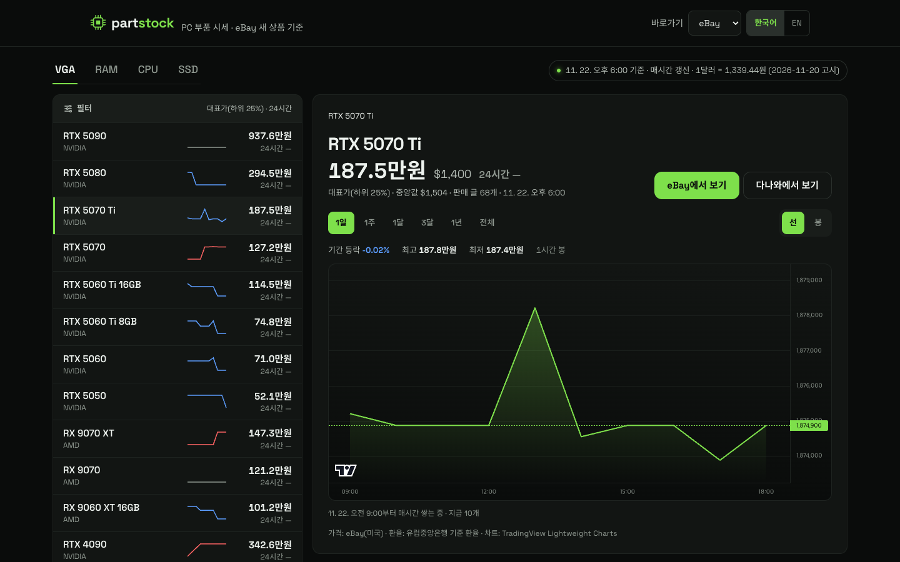
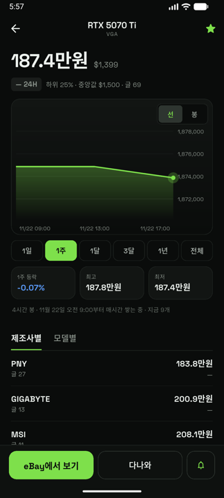
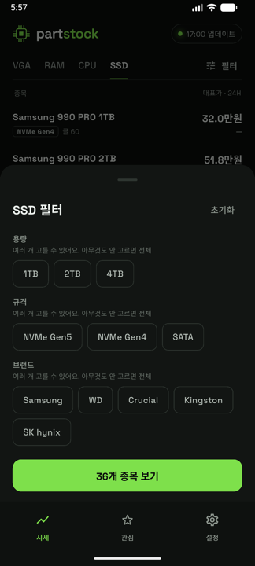
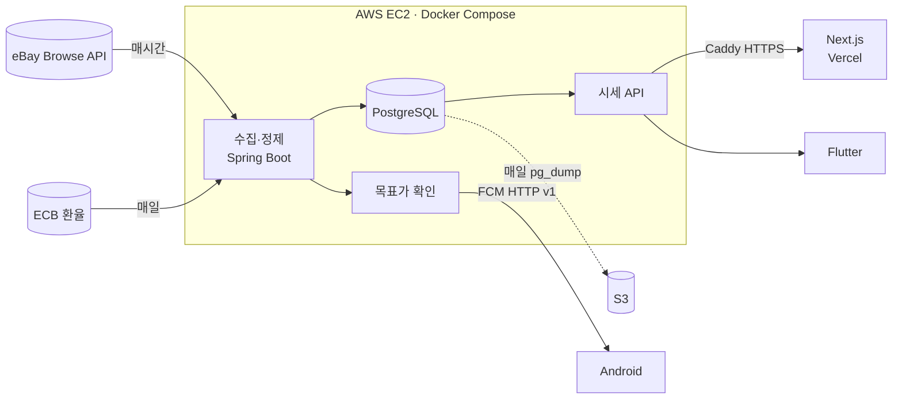

# 파츠스톡 (partstock)

그래픽카드·램·CPU·SSD 시세를 주식 앱처럼 보여 주는 서비스입니다.
미국 eBay 새 상품 판매가를 매시간 수집해 종목별 시세로 정리하고, 원하는 가격이 되면 푸시 알림을 보냅니다.

- 웹: https://partstock-two.vercel.app (한국어 `/ko`, 영어 `/en`)
- 앱: Flutter (Android · iOS), 목표가 알림은 Android
- API: https://32-236-106-139.sslip.io/api/board?category=GPU

**웹**



**앱**

| 시세 목록 | 종목 차트 | 목표가 알림 | 분류별 필터 | 설정 |
|:---:|:---:|:---:|:---:|:---:|
|  |  |  |  |  |

## 주요 기능

- **101개 종목**
  - VGA 27: RTX 50·40, RX 9000·7000
  - RAM 14: DDR5·DDR4, 1개·2개 묶음
  - CPU 24: Ryzen 9000·7000, Core Ultra 200S, 14·13세대
  - SSD 36: 인기 14개 모델 × 용량
- **칩셋 → 제조사 → 모델** 단계별 시세 (예: RTX 5070 Ti → MSI → Gaming Trio)
- **차트**: 1일·1주·1달·3달·1년·전체, 선/캔들, 기간 등락·최고·최저
- **필터**: 분류마다 시리즈·세대·구성·브랜드·용량·규격, 선택값 저장
- **목표가 알림**: 회원가입 없이 FCM 토큰으로 등록, 수집 직후 조건을 확인해 한 번 발송
- **바로가기**: eBay 상품 또는 다나와 검색으로 이동
- **한국어·영어**: 한국어는 원화(빨강 상승·파랑 하락), 영어는 달러

## 아키텍처



| | 기술 |
|---|---|
| 서버 | Java 25, Spring Boot 4.2, PostgreSQL 18, Flyway, JdbcClient, Testcontainers |
| 웹 | Next.js 16 (App Router, Cache Components), Tailwind CSS, Lightweight Charts |
| 앱 | Flutter 3.47, flutter_bloc (Cubit), get_it + injectable, go_router, freezed, fl_chart, FCM |
| 인프라 | AWS EC2 · S3 · IAM Role, Docker Compose, Caddy, Vercel, GitHub Actions, GHCR |

## 시세 계산

eBay 판매 글은 가격 편차가 커서 그대로 평균을 내면 쓸 수 없습니다. 실제 데이터를 보며 아래 규칙을 정했습니다.

1. 새 상품·즉시 구매·USD 글만 사용합니다.
2. 제목으로 종목을 분류합니다. 5070 / 5070 Ti, 9950X3D / 9950X3D2, 990 PRO / 990 EVO Plus처럼 이름이 비슷한 제품을 구분하고, 묶음·외장·고장품·완본체는 제외합니다. 실제 eBay 제목을 테스트 케이스로 유지합니다.
3. 같은 판매자가 같은 가격에 올린 글은 한 번만 셉니다. 한 판매자가 제목만 바꿔 197개를 올려 시세를 덮어 버린 사례가 있었습니다. 판매자명은 해시로만 비교하고 저장하지 않습니다.
4. IQR 기준으로 이상값을 빼고, 대표가는 하위 25% 값을 씁니다. 비싸게 걸어 두고 팔리지 않는 글이 중앙값을 끌어올리기 때문입니다.
5. 글이 5개 미만이면 값을 만들지 않고 "데이터 없음"으로 표시합니다.
6. eBay 약관에 따라 종목별 통계 숫자만 저장하고, 제목·글 번호·판매자 정보는 계산 후 버립니다.

eBay API 무료 한도(하루 5,000회)에 맞춰 검색당 최대 5페이지만 가져옵니다. 5페이지와 10페이지 결과의 대표가가 거의 같은 것을 확인한 뒤 정했고, 현재 사용량은 하루 약 3,200회입니다.

## 트러블슈팅

- **Vercel에서만 종목 주소가 첫 종목을 보여 준 문제**
  Optional catch-all(`[[...key]]`) 페이지에 대해 Vercel이 `/ko/gpu`용으로 미리 렌더링한 결과를 `/ko/gpu/*` 전체에 응답하고 있었습니다. 로컬 `next start`에서는 재현되지 않아, 응답 헤더(`x-matched-path`, `x-vercel-cache`)로 원인을 확인했습니다. 분류 페이지와 종목 페이지를 분리해 해결했습니다.
- **iOS 스와이프 뒤로가기가 안 되던 문제**
  go_router 18은 `material_ui` 패키지의 `MaterialApp`만 인식해서, Flutter 기본 `MaterialApp`을 쓰면 모든 라우트가 `NoTransitionPage`로 만들어집니다. 라우트마다 `MaterialPage`를 직접 지정하고, iOS 제스처 위젯 테스트를 추가했습니다.
- **한 판매자가 램 시세를 좌우하던 문제**
  DDR4 32GB의 하위 25%·중앙값·상위 25%가 모두 같은 값으로 나와 확인해 보니, 판매자 두 명이 같은 가격 글 320개를 올려 둔 상태였습니다. 중복 기준을 "같은 제목 + 같은 가격"에서 "같은 판매자 + 같은 가격"으로 바꿨습니다.
- **배포 직후 새 종목이 404를 반환하던 문제**
  종목 테이블을 수집할 때만 동기화하고 있어서, 다음 정각까지 새 종목이 비어 있었습니다. 서버 시작 시점(`ApplicationReadyEvent`)에도 동기화하도록 바꿨습니다.
- **1GB 서버에서 FCM 발송**
  Firebase Admin SDK 대신 google-auth-library로 토큰만 받아 FCM HTTP v1을 직접 호출합니다. 앱이 삭제된 기기(`UNREGISTERED`)는 정리하고, 일시적 오류는 다음 수집 때 다시 보냅니다.

## 배포

- **서버**: `main`에 push → GitHub Actions에서 테스트 → 이미지를 GHCR에 푸시 → EC2의 systemd 타이머가 1분마다 새 이미지를 확인해 교체 → Actions에서 `/api/version`으로 배포를 확인합니다. 새 버전이 2분 안에 응답하지 않으면 이전 이미지로 롤백합니다. GitHub에는 서버 접속 키나 AWS 키를 두지 않습니다.
- **앱**: push마다 analyze·test·APK 빌드를 확인하고, `app-v*` 태그를 붙이면 서명된 AAB를 Google Play에 업로드합니다.
- **웹**: Vercel이 `main` push마다 배포합니다.
- **백업**: 매일 `pg_dump` 결과를 EC2에 14일치, S3에 전체 보관합니다. 업로드는 EC2 IAM Role로 하며, 해당 버킷에 대한 쓰기 권한만 줬습니다.

## 테스트

- 서버 120개: 제목 분류(실제 eBay 제목), 시세 계산, 수집부터 PostgreSQL 저장까지(Testcontainers), API 응답, 마이그레이션
- 앱 43개: Cubit, 화면 흐름(온보딩, 필터, 목표가 알림, iOS 뒤로가기)
- 웹: 배포된 사이트에서 Playwright로 주소·필터·콘솔 에러 확인

## 실행

```bash
# 서버 (Docker 필요, 로컬·테스트 DB는 자동 실행)
cd server
./gradlew test
cp src/main/resources/application-local.properties.example src/main/resources/application-local.properties  # eBay 키 입력
./gradlew bootRun --args='--spring.profiles.active=local'

# 웹
cd web && npm install
PARTSTOCK_API_URL=http://localhost:8080 npm run dev

# 앱 (기본값은 배포 서버)
cd app && flutter pub get
flutter run   # 로컬 서버: --dart-define=API_URL=http://10.0.2.2:8080
```

## 폴더 구조

```
server/   수집·정제·시세 API·목표가 알림
web/      Next.js 웹
app/      Flutter 앱
deploy/   EC2 배포 스크립트·Compose·Caddy·백업
store/    Play 스토어 등록 자료
docs/     README 이미지
```
