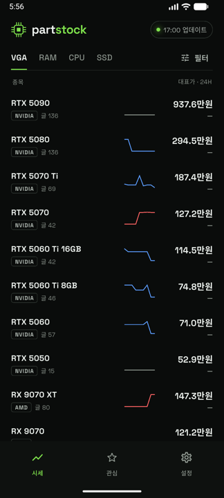
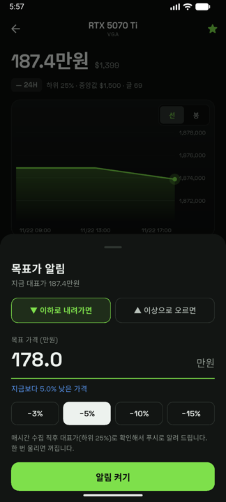
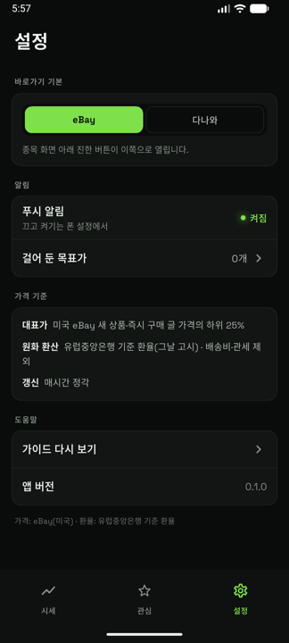
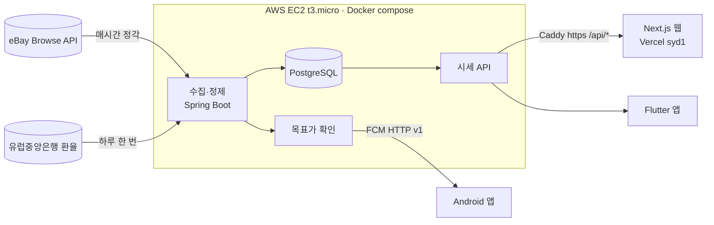

# partstock — PC 부품 시세판

미국 eBay 새 상품 판매가를 **매시간** 모아 그래픽카드·램·CPU·SSD 시세를 코인 거래소처럼 보여 주는 서비스.
종목을 누르면 1일~전체 차트(선·봉)가 나오고, 원하는 가격이 되면 푸시로 알려 준다.

- 웹: https://partstock-two.vercel.app (한국어 `/ko`, 영어 `/en`)
- 앱: Flutter(Android·iOS). Android는 목표가 푸시 알림까지
- API: https://32-236-106-139.sslip.io/api/board?category=GPU

**웹**


**앱**

| 시세 목록 | 종목 차트 | 목표가 알림 | 분류별 필터 | 설정 |
|:---:|:---:|:---:|:---:|:---:|
|  |  |  |  |  |

## 무엇을 하나

- **101개 종목 시세**: VGA 27(RTX 50·40, RX 9000·7000), RAM 14(DDR5·DDR4, 1개·2개 묶음), CPU 24(Ryzen 9000·7000, Core Ultra 200S, 14·13세대), SSD 36(인기 14모델 × 용량)
- **종목 구조**: 칩셋 → 제조사 → 모델(예: RTX 5070 Ti → MSI → Gaming Trio). 같은 판매 글 묶음에서 세 단계 시세를 함께 계산해 서로 어긋나지 않는다
- **차트**: 1일(1시간 봉)·1주(4시간)·1달·3달(일봉)·1년·전체(주봉), 선·봉 전환, 기간 등락·최고·최저
- **분류별 필터**: VGA 시리즈 / RAM 세대·구성 / CPU 브랜드·시리즈 / SSD 용량·규격·브랜드. 분류마다 기억
- **목표가 알림**(Android): 회원 가입 없이 기기 토큰으로. 매시간 수집 직후 대표가가 닿으면 FCM 푸시 한 번
- **바로가기**: eBay(기본) 또는 다나와로 그 상품을 바로 연다
- 한국어(원화 크게 + 달러 작게, 빨강↑파랑↓) / 영어(달러, 청록↑빨강↓)

## 구조



| | 기술 |
|---|---|
| 서버 | Java 25, Spring Boot 4.2, PostgreSQL 18, Flyway, JdbcClient, Testcontainers |
| 웹 | Next.js 16(App Router, Cache Components), Tailwind, TradingView Lightweight Charts |
| 앱 | Flutter 3.47, flutter_bloc(Cubit), get_it + injectable, go_router, freezed, fl_chart, FCM |
| 배포 | AWS EC2(Docker compose, Caddy 자동 https), Vercel, 매일 DB 백업 |

## 데이터를 믿을 수 있게 만든 규칙

eBay 판매 글은 가격이 제멋대로라 그대로 평균을 내면 쓸 수 없다. 실제 데이터를 보고 하나씩 정한 규칙:

1. **새 상품·즉시 구매만**, 달러 글만 센다.
2. **제목으로 종목을 가른다**(`catalog/ListingClassifier`). 비슷한 이름을 구분: 5070 vs 5070 Ti, 4070 Ti vs 4070 Ti Super, 9950X3D vs 9950X3D2, 990 PRO vs 990 EVO Plus, "2000GB" = 2TB. 묶음·외장·고장·완본체 글은 제외. 실제 eBay 제목을 테스트로 고정.
3. **같은 판매자 + 같은 가격은 한 번만** 센다. 한 판매자가 제목만 바꿔 같은 가격에 197개를 올려 시세가 그 값이 된 일이 있었다. 판매자 이름은 되돌릴 수 없는 값으로만 계산 중에 쓰고 저장하지 않는다.
4. **이상값(IQR 1.5배 밖) 제거 후 대표가 = 하위 25%**. 시세보다 몇 배 비싸게 걸어 두고 안 팔리는 글이 중앙값을 끌어올려서.
5. 글이 5개 미만이면 값을 만들지 않고 **"데이터 없음"**으로 둔다.
6. **eBay 약관**: 저장하는 것은 종목별 시세 숫자(대표가·중앙값·최저·최고·글 수)뿐. 제목·글 번호·판매자 같은 원본은 계산 뒤 버린다.

호출 한도(하루 5,000번 무료) 안에서 돌도록 검색마다 최대 5쪽만 받는다. 5쪽·10쪽 결과를 비교해 대표가가 거의 같은 것을 확인하고 정했고, 실제 사용량은 하루 약 3,200번(수집 로그에 매번 남긴다).

## 만들면서 푼 문제

- **"주식처럼 누르면 그래프"가 안 됐다** → 하루 한 번 수집에서 매시간 수집으로, 표 화면에서 코인 거래소 배치(목록 + 큰 차트)로 다시 만듦. 차트는 `date_bin`으로 기간마다 봉을 만든다.
- **Vercel에서만 종목 주소가 첫 종목을 보여 줌** → 선택형 주소(`[[...key]]`) 한 파일을 Vercel이 분류 첫 화면용 미리 만든 화면으로 응답. 로컬 `next start`에서는 재현되지 않아 응답 머리글(`x-matched-path`)로 원인을 찾고, 분류 첫 화면·종목 화면 두 파일로 나눔.
- **iOS 밀어서 뒤로가기가 안 됨** → go_router 18이 Flutter 기본 `MaterialApp`을 알아보지 못해 모든 화면이 전환 없는 페이지였다. 라우트마다 `MaterialPage`를 직접 만들고 iOS 제스처 테스트로 고정.
- **배포 직후 새 종목이 404** → 종목 표를 수집할 때만 맞추던 것을 서버 시작 때도 맞추게.
- **1GB 서버에 FCM** → Firebase Admin SDK 대신 구글 인증 라이브러리 + FCM HTTP v1로 직접 보냄. 앱을 지운 기기(UNREGISTERED)는 정리, 잠깐 실패는 다음 시각에 다시.

과정에서 틀렸던 판단과 고친 방법은 [`docs/AI_LOG.md`](docs/AI_LOG.md)에 시간순으로 남겼다.

## 테스트

- 서버 119개: 제목 판정(실제 eBay 제목), 시세 계산, 수집 → 실제 PostgreSQL 저장(Testcontainers), API 응답 모양, DB 마이그레이션
- 앱 43개: Cubit(늦게 온 응답 버리기, 필터 기억), 화면 흐름(런치 → 가이드 → 목록, 필터, 목표가 알림, iOS 뒤로가기)
- 웹: 배포본에서 주소·필터·콘솔 에러를 브라우저로 확인

## 실행

```bash
# 서버 (Docker 필요: 로컬·테스트용 PostgreSQL이 자동으로 켜짐)
cd server
./gradlew test
cp src/main/resources/application-local.properties.example src/main/resources/application-local.properties  # eBay 키
./gradlew bootRun --args='--spring.profiles.active=local'

# 웹
cd web && npm install
PARTSTOCK_API_URL=http://localhost:8080 npm run dev

# 앱 (기본은 배포된 API)
cd app && flutter pub get
flutter run                                   # 로컬 서버: --dart-define=API_URL=http://10.0.2.2:8080
```

데이터 품질 점검(저장 안 함): `./gradlew bootRun --args='--spring.profiles.active=local,probe --partstock.probe.chipsets=rtx-5070-ti'`

## 폴더

```
server/   수집·정제·시세 API·목표가 알림 (catalog · collect · price · api · alert)
web/      Next.js 웹 (src/app/[lang]/[category], components, lib)
app/      Flutter 앱 (lib/core, lib/features/{board,ticker,watchlist,alerts,settings,onboarding,market})
deploy/   EC2 compose·Caddy·백업·배포 스크립트
docs/     AI_LOG.md, 화면 캡처
```

설계 결정과 규칙은 [`CLAUDE.md`](CLAUDE.md)에 모아 두었다.
